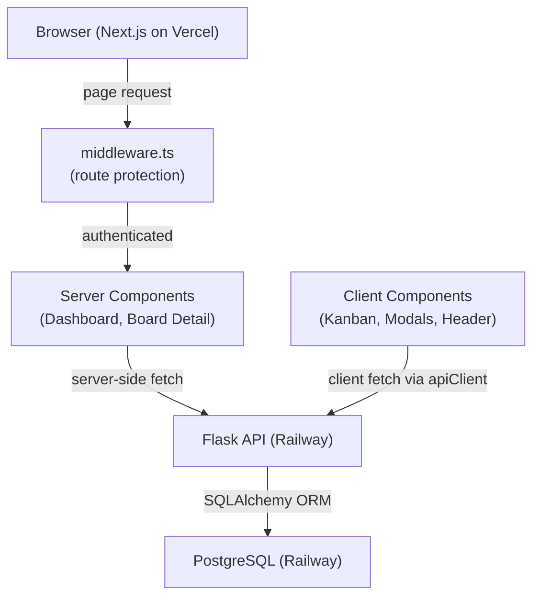

# Design Document — RevoTask MVP

## Overview

RevoTask is a Trello-like task management application composed of two deployables:

- **RevoTask API** — Flask REST API with PostgreSQL, deployed on Railway.
- **RevoTask Web** — Next.js (App Router) frontend, deployed on Vercel.

The API follows the app-factory + Blueprint pattern. Each feature lives in its own Blueprint and is split across three files: `routes.py` (HTTP handling), `service.py` (business logic and queries), and `schema.py` (Marshmallow validation and serialisation). All responses use the JSON envelope `{ "data": ... }` on success and `{ "error": "..." }` on failure.

The Web uses Server Components for data-heavy pages (dashboard, board detail) and Client Component islands for interactivity (drag-and-drop, modals, notifications). Authentication state flows through a `revotask_token` cookie (read by Server Components and `middleware.ts`) and an `AuthContext` (used by Client Components).

---

## Architecture



**Request lifecycle:**

1. `middleware.ts` checks the `revotask_token` cookie. Unauthenticated requests to protected routes are redirected to `/login`.
2. Server Components call `lib/apiClient` with the token from `cookies()` before the HTML is sent to the client.
3. Client Components call `lib/apiClient` with the token from `AuthContext`.
4. `lib/apiClient` throws an `ApiError` on any non-2xx response; `useErrorHandler` maps it to a toast and, for 401, clears the session and redirects to `/login`.
5. Card moves update local state optimistically before the API responds, and roll back on error.

---

## Data Models

> *Section 1 of the design — Flask-SQLAlchemy model definitions.*

All models share a UUID primary key, `created_at`, and `updated_at`.

```python
# app/models/user.py
import uuid
from datetime import datetime, timezone
from werkzeug.security import generate_password_hash, check_password_hash
from app.extensions import db

class User(db.Model):
    __tablename__ = "users"

    id           = db.Column(db.UUID(as_uuid=True), primary_key=True, default=uuid.uuid4)
    name         = db.Column(db.String(100), nullable=False)
    email        = db.Column(db.String(255), unique=True, nullable=False)
    password_hash = db.Column(db.String(255), nullable=False)
    created_at   = db.Column(db.DateTime(timezone=True), default=lambda: datetime.now(timezone.utc))
    updated_at   = db.Column(db.DateTime(timezone=True), default=lambda: datetime.now(timezone.utc), onupdate=lambda: datetime.now(timezone.utc))

    board_memberships = db.relationship("BoardMember", back_populates="user", cascade="all, delete-orphan")
    created_cards     = db.relationship("Card", foreign_keys="Card.created_by", back_populates="creator")
    assigned_cards    = db.relationship("Card", foreign_keys="Card.assignee_id", back_populates="assignee")
    comments          = db.relationship("Comment", back_populates="author", cascade="all, delete-orphan")
    notifications     = db.relationship("Notification", back_populates="user", cascade="all, delete-orphan")

    def set_password(self, password: str) -> None:
        self.password_hash = generate_password_hash(password)

    def check_password(self, password: str) -> bool:
        return check_password_hash(self.password_hash, password)
```

```python
# app/models/board.py
import uuid
from datetime import datetime, timezone
from app.extensions import db

class Board(db.Model):
    __tablename__ = "boards"

    id         = db.Column(db.UUID(as_uuid=True), primary_key=True, default=uuid.uuid4)
    name       = db.Column(db.String(100), nullable=False)
    owner_id   = db.Column(db.UUID(as_uuid=True), db.ForeignKey("users.id"), nullable=False)
    created_at = db.Column(db.DateTime(timezone=True), default=lambda: datetime.now(timezone.utc))
    updated_at = db.Column(db.DateTime(timezone=True), default=lambda: datetime.now(timezone.utc), onupdate=lambda: datetime.now(timezone.utc))

    owner   = db.relationship("User", foreign_keys=[owner_id])
    members = db.relationship("BoardMember", back_populates="board", cascade="all, delete-orphan")
    columns = db.relationship("BoardColumn", back_populates="board", cascade="all, delete-orphan",
                               order_by="BoardColumn.order")
```

```python
# app/models/board_member.py
import uuid
from datetime import datetime, timezone
from app.extensions import db

class BoardMember(db.Model):
    __tablename__ = "board_members"
    __table_args__ = (db.UniqueConstraint("board_id", "user_id", name="uq_board_member"),)

    id         = db.Column(db.UUID(as_uuid=True), primary_key=True, default=uuid.uuid4)
    board_id   = db.Column(db.UUID(as_uuid=True), db.ForeignKey("boards.id"), nullable=False)
    user_id    = db.Column(db.UUID(as_uuid=True), db.ForeignKey("users.id"), nullable=False, index=True)  # NFR-2
    role       = db.Column(db.String(10), nullable=False)   # "admin" | "member"
    created_at = db.Column(db.DateTime(timezone=True), default=lambda: datetime.now(timezone.utc))
    updated_at = db.Column(db.DateTime(timezone=True), default=lambda: datetime.now(timezone.utc), onupdate=lambda: datetime.now(timezone.utc))

    board = db.relationship("Board", back_populates="members")
    user  = db.relationship("User", back_populates="board_memberships")
```

```python
# app/models/column.py
import uuid
from datetime import datetime, timezone
from app.extensions import db

class BoardColumn(db.Model):
    __tablename__ = "columns"

    id         = db.Column(db.UUID(as_uuid=True), primary_key=True, default=uuid.uuid4)
    board_id   = db.Column(db.UUID(as_uuid=True), db.ForeignKey("boards.id"), nullable=False, index=True)  # NFR-2
    name       = db.Column(db.String(100), nullable=False)
    order      = db.Column(db.Float, nullable=False)
    is_done    = db.Column(db.Boolean, default=False, nullable=False)
    created_at = db.Column(db.DateTime(timezone=True), default=lambda: datetime.now(timezone.utc))
    updated_at = db.Column(db.DateTime(timezone=True), default=lambda: datetime.now(timezone.utc), onupdate=lambda: datetime.now(timezone.utc))

    board = db.relationship("Board", back_populates="columns")
    cards = db.relationship("Card", back_populates="column", cascade="all, delete-orphan",
                             order_by="Card.order")
```

```python
# app/models/card.py
import uuid
from datetime import datetime, timezone
from app.extensions import db

class Card(db.Model):
    __tablename__ = "cards"

    id           = db.Column(db.UUID(as_uuid=True), primary_key=True, default=uuid.uuid4)
    column_id    = db.Column(db.UUID(as_uuid=True), db.ForeignKey("columns.id"), nullable=False, index=True)  # NFR-2
    title        = db.Column(db.String(200), nullable=False)
    description  = db.Column(db.String(5000), nullable=True)
    assignee_id  = db.Column(db.UUID(as_uuid=True), db.ForeignKey("users.id"), nullable=True, index=True)  # NFR-2
    created_by   = db.Column(db.UUID(as_uuid=True), db.ForeignKey("users.id"), nullable=False)
    due_date     = db.Column(db.Date, nullable=True)
    priority     = db.Column(db.String(10), default="medium", nullable=False)  # low|medium|high
    order        = db.Column(db.Float, nullable=False)
    completed_at = db.Column(db.DateTime(timezone=True), nullable=True)
    deleted_at   = db.Column(db.DateTime(timezone=True), nullable=True)
    created_at   = db.Column(db.DateTime(timezone=True), default=lambda: datetime.now(timezone.utc))
    updated_at   = db.Column(db.DateTime(timezone=True), default=lambda: datetime.now(timezone.utc), onupdate=lambda: datetime.now(timezone.utc))

    column   = db.relationship("BoardColumn", back_populates="cards")
    creator  = db.relationship("User", foreign_keys=[created_by], back_populates="created_cards")
    assignee = db.relationship("User", foreign_keys=[assignee_id], back_populates="assigned_cards")
    comments = db.relationship("Comment", back_populates="card", cascade="all, delete-orphan")
```

```python
# app/models/comment.py
import uuid
from datetime import datetime, timezone
from app.extensions import db

class Comment(db.Model):
    __tablename__ = "comments"

    id         = db.Column(db.UUID(as_uuid=True), primary_key=True, default=uuid.uuid4)
    card_id    = db.Column(db.UUID(as_uuid=True), db.ForeignKey("cards.id"), nullable=False, index=True)  # NFR-2
    author_id  = db.Column(db.UUID(as_uuid=True), db.ForeignKey("users.id"), nullable=False)
    content    = db.Column(db.String(2000), nullable=False)
    created_at = db.Column(db.DateTime(timezone=True), default=lambda: datetime.now(timezone.utc))
    updated_at = db.Column(db.DateTime(timezone=True), default=lambda: datetime.now(timezone.utc), onupdate=lambda: datetime.now(timezone.utc))

    card   = db.relationship("Card", back_populates="comments")
    author = db.relationship("User", back_populates="comments")
```

```python
# app/models/notification.py
import uuid
from datetime import datetime, timezone
from app.extensions import db

NOTIFICATION_TYPES = ("card_assigned", "comment_added", "board_invite")

class Notification(db.Model):
    __tablename__ = "notifications"

    id         = db.Column(db.UUID(as_uuid=True), primary_key=True, default=uuid.uuid4)
    user_id    = db.Column(db.UUID(as_uuid=True), db.ForeignKey("users.id"), nullable=False, index=True)  # NFR-2
    type       = db.Column(db.String(20), nullable=False)   # card_assigned | comment_added | board_invite
    message    = db.Column(db.String(500), nullable=False)
    is_read    = db.Column(db.Boolean, default=False, nullable=False)
    card_id    = db.Column(db.UUID(as_uuid=True), db.ForeignKey("cards.id", ondelete="SET NULL"), nullable=True)
    board_id   = db.Column(db.UUID(as_uuid=True), db.ForeignKey("boards.id", ondelete="SET NULL"), nullable=True)
    created_at = db.Column(db.DateTime(timezone=True), default=lambda: datetime.now(timezone.utc))
    updated_at = db.Column(db.DateTime(timezone=True), default=lambda: datetime.now(timezone.utc), onupdate=lambda: datetime.now(timezone.utc))

    user  = db.relationship("User", back_populates="notifications")
    card  = db.relationship("Card")
    board = db.relationship("Board")
```

---

## Components and Interfaces

> *Section 2 of the design — API endpoint catalog with request/response contracts for every endpoint in Appendix A.*

## API Endpoint Catalog

### Health

#### `GET /api/health`

| Field | Value |
|-------|-------|
| Blueprint | *(app factory)* |
| Auth required | No |
| Request body | — |
| Success | `200 { "data": { "status": "ok" } }` |
| Errors | `503 { "error": "database unavailable" }` — database unreachable |

---

### Auth Blueprint

#### `POST /api/auth/register`

| Field | Value |
|-------|-------|
| Blueprint | auth |
| Auth required | No |
| Request body | `name` (string, required) · `email` (string, valid email, required) · `password` (string, min 8 chars, required) |
| Success | `201 { "data": UserOut }` — id, name, email (never password_hash) |
| Errors | `400` — missing/invalid fields or password < 8 chars · `409` — email already registered |

#### `POST /api/auth/login`

| Field | Value |
|-------|-------|
| Blueprint | auth |
| Auth required | No |
| Request body | `email` (string, required) · `password` (string, required) |
| Success | `200 { "data": { "access_token": "<jwt>", "user": UserOut } }` |
| Errors | `400` — missing fields · `401` — invalid credentials |

---

### Boards Blueprint

#### `POST /api/boards`

| Field | Value |
|-------|-------|
| Blueprint | boards |
| Auth required | Yes |
| Request body | `name` (string, required) |
| Success | `201 { "data": { "id": "...", "name": "...", "created_at": "..." } }` |
| Errors | `400` — missing name · `401` — no/invalid JWT |

#### `GET /api/boards`

| Field | Value |
|-------|-------|
| Blueprint | boards |
| Auth required | Yes |
| Request body | — |
| Success | `200 { "data": [ BoardOut, ... ] }` — includes each board's id, name, the requesting user's role, and created_at |
| Errors | `401` — no/invalid JWT |

#### `GET /api/boards/<id>`

| Field | Value |
|-------|-------|
| Blueprint | boards |
| Auth required | Yes |
| Request body | — |
| Success | `200 { "data": { "id": "...", "name": "...", "columns": [ { "id": "...", "name": "...", "order": ..., "is_done": ..., "cards": [ ... ] } ] } }` — columns sorted by `order`; cards sorted by `order`; non-deleted cards only |
| Errors | `401` — no/invalid JWT · `404` — board not found or user not a member |

#### `PATCH /api/boards/<id>`

| Field | Value |
|-------|-------|
| Blueprint | boards |
| Auth required | Yes (admin) |
| Request body | `name` (string, required) |
| Success | `200 { "data": { "id": "...", "name": "..." } }` |
| Errors | `400` — missing name · `401` — no/invalid JWT · `403` — not an admin · `404` — board not found or user not a member |

#### `DELETE /api/boards/<id>`

| Field | Value |
|-------|-------|
| Blueprint | boards |
| Auth required | Yes (admin) |
| Request body | — |
| Success | `200 { "data": { "id": "<uuid>" } }` |
| Errors | `401` — no/invalid JWT · `403` — not an admin · `404` — board not found or user not a member |

#### `GET /api/boards/<id>/members`

| Field | Value |
|-------|-------|
| Blueprint | boards |
| Auth required | Yes (any board member) |
| Request body | — |
| Success | `200 { "data": [ MemberOut, ... ] }` |
| Errors | `401` — no/invalid JWT · `404` — board not found or user not a member |

#### `POST /api/boards/<id>/members`

| Field | Value |
|-------|-------|
| Blueprint | boards |
| Auth required | Yes (admin) |
| Request body | `email` (string, required) · `role` (enum `admin`\|`member`, required) |
| Success | `201 { "data": MemberOut }` |
| Errors | `400` — invalid role · `401` — no/invalid JWT · `403` — not an admin · `404` — board not found or user not a member; email not registered · `409` — user already a member |

#### `PATCH /api/boards/<id>/members/<user_id>`

| Field | Value |
|-------|-------|
| Blueprint | boards |
| Auth required | Yes (admin) |
| Request body | `role` (enum `admin`\|`member`, required) |
| Success | `200 { "data": { "user_id": "...", "role": "..." } }` |
| Errors | `400` — invalid role; change would leave board with no admin · `401` — no/invalid JWT · `403` — not an admin · `404` — board not found or user not a member; target member not found |

#### `DELETE /api/boards/<id>/members/<user_id>`

| Field | Value |
|-------|-------|
| Blueprint | boards |
| Auth required | Yes (admin) |
| Request body | — |
| Success | `200 { "data": { "id": "<uuid>" } }` |
| Errors | `400` — removing last admin · `401` — no/invalid JWT · `403` — not an admin · `404` — board not found or user not a member; target member not found |

---

### Columns Blueprint

#### `POST /api/boards/<id>/columns`

| Field | Value |
|-------|-------|
| Blueprint | columns |
| Auth required | Yes (member or admin) |
| Request body | `name` (string, required) |
| Success | `201 { "data": { "id": "...", "name": "...", "order": ..., "is_done": false } }` |
| Errors | `400` — missing name · `401` — no/invalid JWT · `404` — board not found or user not a member |

#### `PATCH /api/columns/<id>`

| Field | Value |
|-------|-------|
| Blueprint | columns |
| Auth required | Yes (member or admin) |
| Request body | `name` (string, optional) · `is_done` (boolean, optional) |
| Success | `200 { "data": { "id": "...", "name": "...", "order": ..., "is_done": ... } }` |
| Errors | `400` — no valid fields · `401` — no/invalid JWT · `404` — column not found or user not a member of its board |

#### `DELETE /api/columns/<id>`

| Field | Value |
|-------|-------|
| Blueprint | columns |
| Auth required | Yes (admin) |
| Request body | — |
| Success | `200 { "data": { "id": "<uuid>" } }` |
| Errors | `401` — no/invalid JWT · `403` — not an admin · `404` — column not found or user not a member of its board |

#### `PATCH /api/boards/<id>/columns/reorder`

| Field | Value |
|-------|-------|
| Blueprint | columns |
| Auth required | Yes (member or admin) |
| Request body | `column_id` (UUID, required) · `order` (float > 0, required) |
| Success | `200 { "data": { "column": ColumnOut, "rebalanced": bool, "column_orders": [ { "id": "<uuid>", "order": float }, ... ] } }` — `column_orders` is populated only when `rebalanced` is true; the client applies `column_orders` to local column state so the next reorder uses fresh order values |
| Errors | `400` — `column_id` not a valid UUID or not on this board; `order` not a float > 0 · `401` — no/invalid JWT · `404` — board not found or user not a member |

---

### Cards Blueprint

#### `GET /api/cards`

| Field | Value |
|-------|-------|
| Blueprint | cards |
| Auth required | Yes |
| Query params | `assignee=me` (optional) · `board_id` (UUID, optional) · `q` (string, optional) |
| Success | `200 { "data": [ CardOut, ... ] }` — never includes soft-deleted cards; CardOut includes board_id and board_name for /my-tasks grouping |
| Errors | `400` — neither `assignee` nor `board_id` provided · `401` — no/invalid JWT · `404` — `board_id` supplied but board not found or user not a member |

#### `POST /api/columns/<id>/cards`

| Field | Value |
|-------|-------|
| Blueprint | cards |
| Auth required | Yes (member or admin) |
| Request body | `title` (string 1–200, required) · `description` (string ≤ 5000, optional) · `assignee_id` (UUID, optional) · `due_date` (date, optional) · `priority` (enum `low`\|`medium`\|`high`, default `medium`, optional) |
| Success | `201 { "data": CardOut }` |
| Errors | `400` — title absent/out of range; description too long; invalid assignee; invalid priority · `401` — no/invalid JWT · `404` — column not found or user not a member of its board |

#### `PATCH /api/cards/<id>`

| Field | Value |
|-------|-------|
| Blueprint | cards |
| Auth required | Yes (member or admin) |
| Request body | `title` (string 1–200, optional) · `description` (string ≤ 5000, optional) · `assignee_id` (UUID, optional) · `due_date` (date, optional) · `priority` (enum, optional) |
| Success | `200 { "data": CardOut }` |
| Errors | `400` — validation failure · `401` — no/invalid JWT · `404` — card not found or user not a member of its board |

#### `DELETE /api/cards/<id>`

| Field | Value |
|-------|-------|
| Blueprint | cards |
| Auth required | Yes (member who created the card, or admin) |
| Request body | — |
| Success | `200 { "data": { "id": "<uuid>" } }` |
| Errors | `401` — no/invalid JWT · `403` — member did not create the card · `404` — card not found or user not a member of its board |

#### `PATCH /api/cards/<id>/position`

| Field | Value |
|-------|-------|
| Blueprint | cards |
| Auth required | Yes (member or admin) |
| Request body | `column_id` (UUID, required — must belong to same board) · `order` (float > 0, required) |
| Success | `200 { "data": { "card": CardOut, "rebalanced": bool, "column_orders": [ { "id": "<uuid>", "order": float }, ... ] } }` — `column_orders` is populated only when `rebalanced` is true; `useDragAndDrop` applies `column_orders` to local state so the next drag uses fresh order values |
| Errors | `400` — `column_id` not a valid UUID, not on same board, or `order` ≤ 0 · `401` — no/invalid JWT · `404` — card not found or user not a member of its board |

---

### Comments Blueprint

#### `POST /api/cards/<id>/comments`

| Field | Value |
|-------|-------|
| Blueprint | comments |
| Auth required | Yes (member or admin) |
| Request body | `content` (string 1–2000, required) |
| Success | `201 { "data": CommentOut }` — includes nested author { id, name } required by CommentList |
| Errors | `400` — content absent or out of range · `401` — no/invalid JWT · `404` — card not found, soft-deleted, or user not a board member |

#### `GET /api/cards/<id>/comments`

| Field | Value |
|-------|-------|
| Blueprint | comments |
| Auth required | Yes (member or admin) |
| Request body | — |
| Success | `200 { "data": [ CommentOut, ... ] }` — chronological order; each CommentOut includes nested author { id, name } |
| Errors | `401` — no/invalid JWT · `404` — card not found, soft-deleted, or user not a board member |

#### `PATCH /api/comments/<id>`

| Field | Value |
|-------|-------|
| Blueprint | comments |
| Auth required | Yes (comment author) |
| Request body | `content` (string 1–2000, required) |
| Success | `200 { "data": CommentOut }` |
| Errors | `400` — content out of range · `401` — no/invalid JWT · `403` — not the author · `404` — comment not found or user not a board member |

#### `DELETE /api/comments/<id>`

| Field | Value |
|-------|-------|
| Blueprint | comments |
| Auth required | Yes (comment author) |
| Request body | — |
| Success | `200 { "data": { "id": "<uuid>" } }` |
| Errors | `401` — no/invalid JWT · `403` — not the author · `404` — comment not found or user not a board member |

---

### Notifications Blueprint

#### `GET /api/notifications`

| Field | Value |
|-------|-------|
| Blueprint | notifications |
| Auth required | Yes |
| Query params | `page` (int ≥ 1, default 1) · `per_page` (int 1–100, default 20) |
| Success | `200 { "data": { "items": [ NotificationOut, ... ], "page": 1, "per_page": 20, "total": 42, "unread_count": 3 } }` — reverse chronological order |
| Errors | `400` — `page` is not an integer >= 1, or `per_page` is not an integer from 1 to 100 · `401` — no/invalid JWT |

#### `PATCH /api/notifications/<id>/read`

| Field | Value |
|-------|-------|
| Blueprint | notifications |
| Auth required | Yes |
| Request body | — |
| Success | `200 { "data": { "id": "...", "is_read": true } }` |
| Errors | `401` — no/invalid JWT · `404` — notification not found or belongs to a different user |

---

### Analytics Blueprint

#### `GET /api/boards/<id>/analytics`

| Field | Value |
|-------|-------|
| Blueprint | analytics |
| Auth required | Yes (admin) |
| Request body | — |
| Success | `200 { "data": { "cards_per_column": [ { "column_id": "...", "column_name": "...", "count": ... } ], "completed_this_week": ..., "member_activity": [ { "user_id": "...", "name": "...", "cards_created": ..., "cards_assigned": ..., "comments_last_7_days": ... } ] } }` |
| Errors | `401` — no/invalid JWT · `403` — not an admin · `404` — board not found or user not a member |

---

### Users Blueprint

#### `GET /api/users/me`

| Field | Value |
|-------|-------|
| Blueprint | users |
| Auth required | Yes |
| Request body | — |
| Success | `200 { "data": UserOut }` — id, name, email; never password_hash |
| Errors | `401` — no/invalid JWT |

#### `PATCH /api/users/me`

| Field | Value |
|-------|-------|
| Blueprint | users |
| Auth required | Yes |
| Request body | `name` (string, optional) · `email` (string valid email, optional) — `password` field rejected with `400` |
| Success | `200 { "data": UserOut }` |
| Errors | `400` — `password` field present; invalid email · `401` — no/invalid JWT · `409` — email already in use |

---

## Backend Folder Structure

```
backend/
├── app/
│   ├── __init__.py               # App factory: create_app(), registers extensions, blueprints, health endpoint, error handlers
│   ├── config.py                 # Config class; normalises DATABASE_URL by replacing a leading "postgres://" with
│   │                             # "postgresql://" (Railway compatibility); required env vars: DATABASE_URL,
│   │                             # SECRET_KEY, JWT_SECRET_KEY, CORS_ORIGINS, FLASK_ENV
│   ├── extensions.py             # Shared extension instances: db, migrate, jwt, cors
│   ├── models/
│   │   ├── __init__.py           # Re-exports all models so Flask-Migrate can discover them
│   │   ├── user.py               # User model: id, name, email, password_hash, set_password(), check_password()
│   │   ├── board.py              # Board model: id, name, owner_id; relationship to BoardMember and Column
│   │   ├── board_member.py       # BoardMember model: board_id, user_id, role; unique constraint (board_id, user_id)
│   │   ├── column.py             # BoardColumn model (class name) with __tablename__ = "columns": id, board_id, name, order (Float), is_done
│   │   ├── card.py               # Card model: id, column_id, title, description, priority, order (Float), completed_at, deleted_at
│   │   ├── comment.py            # Comment model: id, card_id, author_id, content (max 2000)
│   │   └── notification.py       # Notification model: id, user_id, type, message, is_read, card_id (nullable), board_id (nullable)
│   └── blueprints/
│       ├── auth/
│       │   ├── routes.py         # POST /api/auth/register, POST /api/auth/login — parses request, calls service, returns JSON
│       │   ├── service.py        # register_user(), login_user() — hashing, JWT creation, duplicate-email check
│       │   └── schema.py         # RegisterSchema, LoginSchema
│       ├── boards/
│       │   ├── routes.py         # CRUD /api/boards, /api/boards/<id>/members — HTTP layer only
│       │   ├── service.py        # create_board(), list_boards(), get_board(), rename_board(), delete_board(),
│       │   │                     # list_members(), add_member(), update_member_role(), remove_member()
│       │   │                     # get_board() uses selectinload(Board.columns).selectinload(BoardColumn.cards)
│       │   │                     # with an AND filter Card.deleted_at.is_(None) so soft-deleted cards
│       │   │                     # are excluded at the ORM level, not filtered after loading
│       │   └── schema.py         # BoardSchema, MemberAddSchema, MemberRoleSchema
│       ├── columns/
│       │   ├── routes.py         # POST /api/boards/<id>/columns, PATCH /api/columns/<id>, DELETE, PATCH reorder
│       │   ├── service.py        # create_column(), update_column(), delete_column(), reorder_column()
│       │   │                     # Implements FLOAT order strategy and rebalance logic
│       │   └── schema.py         # ColumnSchema, ColumnReorderSchema
│       ├── cards/
│       │   ├── routes.py         # GET /api/cards, POST /api/columns/<id>/cards, PATCH, DELETE, PATCH position
│       │   ├── service.py        # list_cards(), create_card(), update_card(), soft_delete_card(), move_card()
│       │   │                     # Handles completed_at lifecycle and FLOAT order/rebalance; triggers notifications
│       │   └── schema.py         # CardSchema, CardPositionSchema, CardQuerySchema
│       ├── comments/
│       │   ├── routes.py         # POST/GET /api/cards/<id>/comments, PATCH/DELETE /api/comments/<id>
│       │   ├── service.py        # create_comment(), list_comments(), update_comment(), delete_comment()
│       │   │                     # Triggers comment_added notification
│       │   └── schema.py         # CommentSchema
│       ├── notifications/
│       │   ├── routes.py         # GET /api/notifications, PATCH /api/notifications/<id>/read
│       │   ├── service.py        # list_notifications(), mark_as_read(); create_notification() used by other services
│       │   └── schema.py         # NotificationQuerySchema
│       ├── analytics/
│       │   ├── routes.py         # GET /api/boards/<id>/analytics
│       │   ├── service.py        # get_analytics() — SQLAlchemy joins, no N+1 queries
│       │   └── schema.py         # AnalyticsSchema
│       └── users/
│           ├── routes.py         # GET /api/users/me, PATCH /api/users/me
│           ├── service.py        # get_current_user(), update_user() — rejects password field, checks email uniqueness
│           └── schema.py         # UserSchema (response, no password_hash), UserUpdateSchema
├── migrations/                   # Flask-Migrate auto-generated migration scripts
├── tests/
│   ├── conftest.py           # pytest fixtures: app, client, db session, test users, auth headers
│   ├── test_auth.py          # Register and login: success, 400, 409, 401
│   ├── test_boards.py        # Board CRUD and member management: success paths + 400/401/403/404/409
│   ├── test_columns.py       # Column CRUD and reorder: success paths + 400/401/403/404
│   ├── test_cards.py         # Card CRUD, soft-delete, position move: success paths + 400/401/403/404
│   ├── test_comments.py      # Comment CRUD: 201 success, 400 missing content, 401 unauth, 403 not owner
│   ├── test_notifications.py # List and mark-read: success + 400/401/404
│   ├── test_analytics.py     # Analytics: success + 401/403/404
│   └── test_users.py         # Profile get/update: success + 400/401/409
├── wsgi.py                       # Gunicorn entry point: from app import create_app; app = create_app()
├── requirements.txt              # All Python dependencies
└── .env.example                  # Template listing required environment variables (no real values)
```

---

## Frontend Folder Structure (Next.js App Router)

```
frontend/
├── middleware.ts             # Next.js Edge middleware (Next.js 16+: proxy.ts). Reads revotask_token cookie;
│                             # redirects unauthenticated users from protected routes to /login.
│                             # /login and /register are explicitly excluded from protection.
├── app/
│   ├── layout.tsx            # Root layout: wraps children with AuthContextProvider and react-hot-toast Toaster only
│   ├── login/
│   │   └── page.tsx          # Login form — Client Component; controlled inputs; stores token on success
│   ├── register/
│   │   └── page.tsx          # Register form — Client Component; client-side validation before API call
│   └── (app)/
│       ├── layout.tsx        # Authenticated route-group layout: renders Header (with NotificationBell);
│       │                     # wraps /, /boards/[id], /my-tasks and /profile — never /login or /register
│       ├── page.tsx          # Dashboard — Server Component; fetches GET /api/boards server-side via apiClient
│       ├── boards/
│       │   └── [id]/
│       │       └── page.tsx  # Board detail — Server Component; fetches GET /api/boards/<id> server-side;
│       │                     # renders KanbanBoard client island
│       ├── my-tasks/
│       │   └── page.tsx      # My Tasks — Server Component or Client Component; calls GET /api/cards?assignee=me;
│       │                     # groups cards by board name; uses BaseBadge for priority
│       └── profile/
│           └── page.tsx      # Profile — Client Component; controlled inputs pre-filled from AuthContext;
│                             # sends PATCH /api/users/me; shows success toast

components/
├── shared/
│   ├── BaseButton.tsx        # Button with variant prop: primary | secondary | destructive
│   ├── BaseBadge.tsx         # Badge with color variants for priority: low | medium | high; always includes text
│   └── BaseModal.tsx         # Modal wrapper; closes on Escape; returns focus to trigger element on close
├── board/
│   ├── KanbanBoard.tsx       # Client island: owns drag-and-drop state; renders ColumnList; manages card search
│   ├── ColumnList.tsx        # Renders ordered columns; composes AddColumnForm and AddCardForm
│   ├── CardItem.tsx          # Draggable card row; drag handle uses useDragAndDrop; opens CardDetailModal on click
│   ├── CardDetailModal.tsx   # Client Component inside BaseModal; editable card fields; "Move to column" select;
│   │                         # calls PATCH /api/cards/<id> and PATCH /api/cards/<id>/position; composes CommentList
│   ├── CommentList.tsx       # Renders comments chronologically; shows edit/delete controls to comment author only;
│   │                         # calls PATCH /api/comments/<id> and DELETE /api/comments/<id>
│   ├── CreateBoardModal.tsx  # Client Component inside BaseModal; create-board form; calls POST /api/boards;
│   │                         # calls router.refresh() after success to reload the dashboard Server Component (REQ-26.5)
│   ├── AddColumnForm.tsx     # Client Component inside BaseModal; add-column form; calls POST /api/boards/<id>/columns (REQ-27.4)
│   └── AddCardForm.tsx       # Client Component inside BaseModal; add-card form; calls POST /api/columns/<id>/cards (REQ-27.5)
├── notifications/
│   └── NotificationBell.tsx  # Displays unread count from useNotifications; opens notification list dropdown;
│                             # calls PATCH /api/notifications/<id>/read on click; decrements count
└── Header.tsx                # Client Component: navigation links (/  /my-tasks  /profile),
                              # NotificationBell, logout button (clears cookie + AuthContext, redirects to /login)

hooks/
├── useDragAndDrop.ts         # Native HTML5 Drag and Drop API; on drop calls PATCH /api/cards/<id>/position;
│                             # updates state optimistically; rolls back and shows error toast on API failure
├── useNotifications.ts       # Polls GET /api/notifications every 30 seconds; exposes unread count and
│                             # notification list; used by NotificationBell
└── useErrorHandler.ts        # Accepts ApiError; maps statusCode to toast message; on 401 clears session
│                             # and redirects to /login; on 403 shows "not allowed"; 404 "not found";
│                             # 400 shows validation message; 409 shows conflict message; 5xx generic error

lib/
├── apiClient.ts              # Typed fetch wrapper; reads NEXT_PUBLIC_API_BASE_URL (client) or API_BASE_URL
│                             # (server); attaches Authorization: Bearer <token>; throws ApiError on non-2xx
├── errors.ts                 # ApiError class: statusCode (number), message (string)
├── toast.ts                  # Thin wrappers: success(), error(), loading() over react-hot-toast
└── auth.ts                   # Cookie helpers: getToken(), setToken(token, expires), clearToken()
│                             # used by login page, middleware, and logout action

context/
└── AuthContext.tsx           # React context: holds { user, token }; hydrated from revotask_token cookie on
                              # mount; exposes setAuth() and clearAuth()

types/
└── index.ts                  # TypeScript interfaces: User, Board, BoardMember, Column, Card, Comment,
                              # Notification, ApiError, PaginatedResponse<T>
.env.example                  # Template listing required frontend environment variables (no real values):
                              # NEXT_PUBLIC_API_BASE_URL (used by Client Components via lib/apiClient)
                              # API_BASE_URL (used by Server Components via lib/apiClient)
```

---

## Key Design Decisions

### FLOAT Order Strategy (§5.12)

Cards within a column and columns within a board are ordered by a `db.Float` field named `order`. The assignment strategy is:

- **Append to end:** `order = last.order + 1024`
- **Insert between two items:** `order = (prev.order + next.order) / 2`
- **Insert at top:** `order = first.order / 2`
- **Rebalance:** when the gap between any two neighbouring `order` values drops below `1e-6`, the service renumbers all items in that scope (column's cards or board's columns) to `1024, 2048, 3072, …` in a single database transaction.

The first item in an empty collection always gets `order = 1024`. Rebalancing is triggered inside the service layer immediately after detecting the gap condition, before the transaction commits. `ColumnReorderSchema` and `CardPositionSchema` validate that `order` is a float greater than 0.

### `completed_at` Lifecycle (§5.5)

A `Column` carries a boolean `is_done` flag (default `false`). When `PATCH /api/cards/<id>/position` moves a card:

- Into a column where `is_done = true` → `completed_at` is set to the current UTC timestamp.
- Out of an `is_done = true` column into an `is_done = false` column → `completed_at` is cleared to `null`.

The service layer is responsible for this transition; it checks both the source and destination column's `is_done` values within the same transaction as the position update. Board analytics counts cards completed this week by filtering `completed_at` in the range `[current ISO week Monday 00:00 UTC, now]`.

### JWT Dual-Storage (§5.4)

On successful login the Web stores the JWT in two places:

1. **`revotask_token` cookie** — `SameSite=Lax`, `Secure` in production, expiry equal to the JWT's 24-hour lifetime. Read by `middleware.ts` for route protection and by Server Components via Next.js `cookies()`.
2. **`AuthContext`** — hydrated from the cookie on page load. Used by Client Components and `lib/apiClient` when running in the browser.

Logout is client-side only: `clearToken()` removes the cookie, `clearAuth()` wipes `AuthContext`, then the user is redirected to `/login`. No server-side token revocation endpoint exists (JWTs are stateless; a blocklist is out of scope).

### Soft-Delete for Cards (§5.8)

`DELETE /api/cards/<id>` sets `card.deleted_at` to the current UTC timestamp (soft-delete). Every read query in the service layer filters `WHERE deleted_at IS NULL`. A soft-deleted card is never returned from any read endpoint including `GET /api/boards/<id>`, `GET /api/cards`, or `GET /api/cards/<id>/comments`.

Boards and columns are **hard-deleted** via `DELETE` with cascade to their children. Deleting a column is restricted to admins because it removes all cards in that column.

### Optimistic UI for Card Moves

When a card is dropped onto a new column or position, `useDragAndDrop` immediately updates the local React state to reflect the new position, then calls `PATCH /api/cards/<id>/position`. If the API returns an error response:

1. The local state is restored to the card's pre-drop position.
2. `useErrorHandler` displays an error toast via `lib/toast`.

The `CardDetailModal` "Move to column" select calls the same endpoint, using the same error-handling path, to support card moves on mobile where drag-and-drop is unavailable.

### Authorization Model

- A user who is **not a board member** receives `404` for the board and all its sub-resources (columns, cards, comments, analytics), so the board's existence is not leaked to non-members.
- A board member who **lacks the required role or ownership** receives `403`.
- Authorization checks (membership lookup, role verification, ownership verification) are performed in `service.py`. `routes.py` only parses the HTTP request and formats the response.
- `GET /api/boards/<id>/members` is accessible to any board member because the assignee picker in the card detail form requires it. All write operations on members are admin-only.

### `CardPositionSchema` Validation

`CardPositionSchema` validates:
- `column_id` — must be a valid UUID and must belong to the same board as the card being moved; checked in `service.py` after schema validation.
- `order` — must be a float greater than `0`.

If `column_id` is not a valid UUID, Marshmallow returns `400`. If it is a valid UUID but does not belong to the same board, the service returns `400`.

### Password Hashing

Passwords are stored using Werkzeug's `generate_password_hash` and verified with `check_password_hash`. The minimum password length of 8 characters is enforced by `RegisterSchema` via `validate=validate.Length(min=8)`. The `password_hash` field is never included in any Marshmallow response schema. `UserUpdateSchema` explicitly rejects a `password` field with `400`.

### Response Envelope

Every API response uses the JSON envelope:
- **Success:** `{ "data": ... }`
- **Error:** `{ "error": "<human-readable message>" }`
- **Delete:** `200 { "data": { "id": "<uuid>" } }` — `204` is never used.
- **Pagination:** `{ "data": { "items": [...], "page": <int>, "per_page": <int>, "total": <int> } }` with an additional `unread_count` field for notifications.

Unhandled exceptions in production return a JSON `500` error envelope, never an HTML page or stack trace. The app factory registers a catch-all error handler for this. `debug = False` in production config.

### Notification Triggers

| ID | Event | Recipient | Excluded |
|----|-------|-----------|----------|
| N1 | Card assigned to a user | New assignee | The user who performed the action |
| N2 | Comment added to a card | Card creator + card assignee | The user who added the comment |
| N3 | User added to a board | The added user | — |

Notification creation is handled inside the relevant service functions (`cards/service.py` for N1, `comments/service.py` for N2, `boards/service.py` for N3) by calling `notifications/service.py:create_notification()`.

### Member Access

`GET /api/boards/<id>/members` is open to any board member because the card detail form needs to populate the assignee picker. `POST`, `PATCH`, and `DELETE` on `/api/boards/<id>/members` are restricted to admins. Removing the last remaining admin is rejected with `400`; demoting the last admin via `PATCH` role is also rejected with `400`.

---

## Response Schemas

> *Marshmallow dump-only schemas used to serialise API responses. These are used in the endpoint catalog below. The `password_hash` field is never included in any response schema.*

```python
# app/blueprints/users/schema.py (dump)
class UserOut(Schema):
    id    = fields.UUID(dump_only=True)
    name  = fields.String(dump_only=True)
    email = fields.Email(dump_only=True)

# app/blueprints/boards/schema.py (dump)
class BoardOut(Schema):
    id         = fields.UUID(dump_only=True)
    name       = fields.String(dump_only=True)
    role       = fields.String(dump_only=True)   # the requesting user's role on this board
    created_at = fields.DateTime(dump_only=True)

# app/blueprints/columns/schema.py (dump)
class ColumnOut(Schema):
    id       = fields.UUID(dump_only=True)
    board_id = fields.UUID(dump_only=True)
    name     = fields.String(dump_only=True)
    order    = fields.Float(dump_only=True)
    is_done  = fields.Boolean(dump_only=True)

# app/blueprints/cards/schema.py (dump)
class AssigneeOut(Schema):
    id   = fields.UUID(dump_only=True)
    name = fields.String(dump_only=True)

class CardOut(Schema):
    id           = fields.UUID(dump_only=True)
    column_id    = fields.UUID(dump_only=True)
    board_id     = fields.UUID(dump_only=True)
    board_name   = fields.String(dump_only=True)   # required by /my-tasks (REQ-12.4)
    title        = fields.String(dump_only=True)
    description  = fields.String(dump_only=True, allow_none=True)
    priority     = fields.String(dump_only=True)
    due_date     = fields.Date(dump_only=True, allow_none=True)
    order        = fields.Float(dump_only=True)
    completed_at = fields.DateTime(dump_only=True, allow_none=True)
    created_by   = fields.UUID(dump_only=True)
    assignee     = fields.Nested(AssigneeOut, dump_only=True, allow_none=True)

# app/blueprints/comments/schema.py (dump)
class AuthorOut(Schema):
    id   = fields.UUID(dump_only=True)
    name = fields.String(dump_only=True)

class CommentOut(Schema):
    id         = fields.UUID(dump_only=True)
    card_id    = fields.UUID(dump_only=True)
    content    = fields.String(dump_only=True)
    created_at = fields.DateTime(dump_only=True)
    updated_at = fields.DateTime(dump_only=True)
    author     = fields.Nested(AuthorOut, dump_only=True)   # required by CommentList (REQ-28)

# app/blueprints/notifications/schema.py (dump)
class NotificationOut(Schema):
    id         = fields.UUID(dump_only=True)
    type       = fields.String(dump_only=True)
    message    = fields.String(dump_only=True)
    is_read    = fields.Boolean(dump_only=True)
    card_id    = fields.UUID(dump_only=True, allow_none=True)
    board_id   = fields.UUID(dump_only=True, allow_none=True)
    created_at = fields.DateTime(dump_only=True)

# app/blueprints/boards/schema.py (dump)
class MemberOut(Schema):
    user_id = fields.UUID(dump_only=True)
    name    = fields.String(dump_only=True)
    email   = fields.Email(dump_only=True)
    role    = fields.String(dump_only=True)
```

---

## Marshmallow Schemas (key schemas)

```python
# app/blueprints/auth/schema.py
from marshmallow import Schema, fields, validate

class RegisterSchema(Schema):
    name     = fields.String(required=True, validate=validate.Length(min=1, max=100))
    email    = fields.Email(required=True)
    password = fields.String(required=True, validate=validate.Length(min=8), load_only=True)

class LoginSchema(Schema):
    email    = fields.Email(required=True)
    password = fields.String(required=True, load_only=True)
```

```python
# app/blueprints/boards/schema.py
from marshmallow import Schema, fields, validate

class BoardSchema(Schema):
    name = fields.String(required=True, validate=validate.Length(min=1, max=100))

class MemberAddSchema(Schema):
    email = fields.Email(required=True)
    role  = fields.String(required=True, validate=validate.OneOf(["admin", "member"]))

class MemberRoleSchema(Schema):
    role = fields.String(required=True, validate=validate.OneOf(["admin", "member"]))
```

```python
# app/blueprints/columns/schema.py
from marshmallow import Schema, fields, validate

class ColumnSchema(Schema):
    name    = fields.String(required=True, validate=validate.Length(min=1, max=100))
    is_done = fields.Boolean(load_default=False)

class ColumnUpdateSchema(Schema):
    name    = fields.String(validate=validate.Length(min=1, max=100))
    is_done = fields.Boolean()

class ColumnReorderSchema(Schema):
    column_id = fields.UUID(required=True)
    order     = fields.Float(required=True, validate=validate.Range(min=0, min_inclusive=False))
```

```python
# app/blueprints/cards/schema.py
from marshmallow import Schema, fields, validate

class CardSchema(Schema):
    title       = fields.String(required=True, validate=validate.Length(min=1, max=200))
    description = fields.String(validate=validate.Length(max=5000), allow_none=True)
    assignee_id = fields.UUID(allow_none=True)
    due_date    = fields.Date(allow_none=True)
    priority    = fields.String(
        load_default="medium",
        validate=validate.OneOf(["low", "medium", "high"])
    )

class CardUpdateSchema(Schema):
    title       = fields.String(validate=validate.Length(min=1, max=200))
    description = fields.String(validate=validate.Length(max=5000), allow_none=True)
    assignee_id = fields.UUID(allow_none=True)
    due_date    = fields.Date(allow_none=True)
    priority    = fields.String(validate=validate.OneOf(["low", "medium", "high"]))

class CardPositionSchema(Schema):
    column_id = fields.UUID(required=True)
    order     = fields.Float(required=True, validate=validate.Range(min=0, min_inclusive=False))

class CardQuerySchema(Schema):
    assignee = fields.String(validate=validate.OneOf(["me"]))
    board_id = fields.UUID()
    q        = fields.String()
    # Service layer must return 400 { "error": "assignee or board_id is required" }
    # if neither assignee nor board_id is provided in the request.
```

```python
# app/blueprints/comments/schema.py
from marshmallow import Schema, fields, validate

class CommentSchema(Schema):
    content = fields.String(required=True, validate=validate.Length(min=1, max=2000))
```

```python
# app/blueprints/notifications/schema.py
from marshmallow import Schema, fields, validate

class NotificationQuerySchema(Schema):
    page     = fields.Integer(load_default=1,  validate=validate.Range(min=1))
    per_page = fields.Integer(load_default=20, validate=validate.Range(min=1, max=100))
```

```python
# app/blueprints/users/schema.py
from marshmallow import Schema, fields, validate, validates, ValidationError

class UserUpdateSchema(Schema):
    name  = fields.String(validate=validate.Length(min=1, max=100))
    email = fields.Email()

    @validates("password")
    def reject_password(self, value):
        raise ValidationError("Password updates are not allowed via this endpoint.")

    # Declared to trigger the validator if the key is present in the payload
    password = fields.String(load_only=True)
```

---

## Correctness Properties

*A property is a characteristic or behavior that should hold true across all valid executions of a system — essentially, a formal statement about what the system should do. Properties serve as the bridge between human-readable specifications and machine-verifiable correctness guarantees.*

### Property 1: FLOAT Order Insert Preserves Sort Order

*For any* ordered list of columns or cards and any new item inserted at an arbitrary position, the resulting list sorted by `order` must reflect the intended position (i.e., the new item appears between its intended predecessor and successor).

**Validates: Requirements 6.5, 9.6**

### Property 2: Rebalance Preserves Relative Order

*For any* list of columns or cards that triggers a rebalance (gap < `1e-6`), after renumbering to `1024, 2048, 3072, …` the relative order of all items must be identical to the order before rebalancing.

**Validates: Requirements 6.5, 9.6**

### Property 3: Soft-Delete Exclusion

*For any* board and any read endpoint that returns cards (GET /api/boards/<id>, GET /api/cards, GET /api/cards/<id>/comments), no card with a non-null `deleted_at` must appear in the response.

**Validates: Requirements 8.4, 12.3**

### Property 4: completed_at Round-Trip

*For any* card moved into an `is_done` column and then moved back into a non-`is_done` column, `completed_at` must be `null` after the second move.

**Validates: Requirements 9.4, 9.5**

### Property 5: Notification Self-Exclusion

*For any* triggering event (card assignment, comment addition, board invite), the user who performed the action must not appear in the set of notification recipients.

**Validates: Requirements 11.1, 11.2, 11.3**

### Property 6: Password Never in Response

*For any* API response (register, login, GET /api/users/me, PATCH /api/users/me, any board/member list), the serialised JSON must not contain a `password` or `password_hash` key.

**Validates: Requirements 2.1, 2.4, 14.1**

### Property 7: Non-Member Gets 404, Not 403

*For any* board B and any user U who is not a BoardMember of B, any request to `/api/boards/<B.id>` or its sub-resources must return `404` rather than `403` or `200`.

**Validates: Requirements 5.6, 7.7, 10.8**

### Property 8: Response Envelope Invariant

*For any* API response, the top-level JSON object must contain exactly one of the keys `data` (on success) or `error` (on failure), and never both.

**Validates: Requirements 17.1, 17.2**

---

## Error Handling

### API Error Handling

The app factory registers the following error handlers in `app/__init__.py`:

| Scenario | Handler | Response |
|----------|---------|----------|
| Marshmallow `ValidationError` | `@app.errorhandler(ValidationError)` — imported from `marshmallow`; plain Marshmallow raises this directly, not HTTP 422 | `400 { "error": "<first validation message>" }` |
| `werkzeug.exceptions.NotFound` | `@app.errorhandler(404)` | `404 { "error": "not found" }` |
| `werkzeug.exceptions.HTTPException` | `@app.errorhandler(HTTPException)` — catches all Werkzeug HTTP errors including 400 (malformed JSON body), 405 (method not allowed), 415 (unsupported media type); prevents the catch-all `Exception` handler from converting them to 500 | `e.code { "error": e.description }` |
| Flask-JWT-Extended loaders | `@jwt.unauthorized_loader` (missing token) · `@jwt.invalid_token_loader` (malformed/wrong-type token) · `@jwt.expired_token_loader` (token past expiry) — all registered via `jwt = JWTManager(app)` in `extensions.py`; the library default of `{ "msg": ... }` and `422` for malformed tokens is overridden by these loaders | `401 { "error": "missing or invalid token" }` |
| Unhandled `Exception` | `@app.errorhandler(Exception)` | `500 { "error": "internal server error" }` — stack trace never exposed; `debug=False` in production |

Service-layer functions raise `AppError(status_code: int, message: str)` — a thin custom exception defined in `backend/app/exceptions.py`. The app factory registers a single `@app.errorhandler(AppError)` handler that converts it to `{ "error": message }` with the given status code. `routes.py` contains no `try/except` for business errors; it only parses the HTTP request, calls the service function, and returns the JSON response.

### Web Error Handling

`useErrorHandler` in `hooks/useErrorHandler.ts` is the single point for mapping `ApiError` to user-facing feedback:

| `statusCode` | Action |
|-------------|--------|
| `400` | `lib/toast.error(error.message)` — shows validation message from envelope |
| `401` | `lib/toast.error("session expired")` → clear cookie → clear AuthContext → redirect `/login` |
| `403` | `lib/toast.error("not allowed")` |
| `404` | `lib/toast.error("not found")` |
| `409` | `lib/toast.error(error.message)` — shows conflict message from envelope |
| `500`–`599` | `lib/toast.error("something went wrong, please try again")` |

---

## Testing Strategy

### Backend (pytest)

Each blueprint has a dedicated test file in `tests/`. Tests use a separate PostgreSQL test database (configured via environment variable). `conftest.py` provides fixtures for the Flask test client, a clean database session per test, and pre-built authenticated users.

Coverage per blueprint:

- **Success path** (2xx) for every endpoint.
- **400** validation errors where applicable.
- **401** missing or invalid JWT for every protected endpoint.
- **403** wrong role or ownership for applicable endpoints.
- **404** non-existent or non-member resource for applicable endpoints.
- **409** conflict (duplicate email, duplicate board member) where applicable.

Properties 1–3 are tested with ordinary pytest cases: parameterised tests for the order-insert invariant and rebalance, and an explicit soft-delete exclusion test in `test_cards.py`.

### Frontend (Jest + React Testing Library)

Unit tests for hooks (`useDragAndDrop`, `useNotifications`, `useErrorHandler`) and shared components (`BaseButton`, `BaseBadge`, `BaseModal`). Tests use `role` and `data-testid` selectors. `useDragAndDrop` is tested with a mocked API error to verify that the card position is restored and an error toast is shown; `useErrorHandler` is tested to verify that each status code maps to the correct toast message.

### End-to-End (Playwright)

Runs against the live Vercel + Railway deployment. Uses `role` and `data-testid` selectors; no `waitForTimeout`.

**Auth scenarios (4):**
1. Successful login redirects to `/`.
2. Invalid credentials show an error message.
3. Unauthenticated visit to `/` redirects to `/login`.
4. After logout, visiting `/` redirects to `/login`.

**Kanban journey (8 steps):**
1. Log in.
2. Create a board.
3. Add a "To Do" column.
4. Add a "Done" column.
5. Create a card in "To Do".
6. Drag the card to "Done" (using `locator.dragTo()`; wait for `PATCH /api/cards/<id>/position` response with `waitForResponse`).
7. Reload the page.
8. Assert the card is still in "Done".

---

## Traceability Table

| REQ | Criteria | Requirement Title | Implemented By |
|-----|----------|-------------------|----------------|
| REQ-1 | 1, 3 | Health Check | `GET /api/health` (app factory `backend/app/__init__.py`) |
| REQ-1 | 2 | Health Check — DB error | `GET /api/health` error handler in app factory |
| REQ-2 | 1–4 | User Registration — API | `POST /api/auth/register` (auth blueprint) |
| REQ-2 | 5 | User Registration — Web | `frontend/app/register/page.tsx` |
| REQ-3 | 1–2 | User Login — API | `POST /api/auth/login` (auth blueprint) |
| REQ-3 | 3–5 | User Login — Web token storage | `frontend/app/login/page.tsx` + `frontend/lib/auth.ts` + `frontend/context/AuthContext.tsx` |
| REQ-3 | 6 | User Login — error display | `frontend/app/login/page.tsx` |
| REQ-4 | 1 | Protected Routes — Web redirect | `frontend/middleware.ts` |
| REQ-4 | 2 | Protected Routes — API 401 | All protected blueprint routes via Flask-JWT-Extended |
| REQ-4 | 3–4 | Logout | `frontend/components/Header.tsx` + `frontend/lib/auth.ts` + `frontend/context/AuthContext.tsx` |
| REQ-5 | 1 | Board Creation — API | `POST /api/boards` (boards blueprint) |
| REQ-5 | 2 | Board List — API | `GET /api/boards` (boards blueprint) |
| REQ-5 | 3 | Board Detail — API | `GET /api/boards/<id>` (boards blueprint) |
| REQ-5 | 4 | Board Rename — API | `PATCH /api/boards/<id>` (boards blueprint) |
| REQ-5 | 5 | Board Delete — API | `DELETE /api/boards/<id>` (boards blueprint) |
| REQ-5 | 6 | Board 404 for non-members | boards `service.py` membership check |
| REQ-5 | 7 | Board 403 for members | boards `service.py` role check |
| REQ-6 | 1 | Column Create — API | `POST /api/boards/<id>/columns` (columns blueprint) |
| REQ-6 | 2 | Column Rename/is_done — API | `PATCH /api/columns/<id>` (columns blueprint) |
| REQ-6 | 3 | Column Delete — API | `DELETE /api/columns/<id>` (columns blueprint) |
| REQ-6 | 4 | Column Delete 403 | columns `service.py` admin check |
| REQ-6 | 5 | FLOAT order strategy | columns `service.py` + cards `service.py` |
| REQ-6 | 6 | is_done flag | `BoardColumn` model + columns `service.py` |
| REQ-6 | 7 | Column Reorder — API | `PATCH /api/boards/<id>/columns/reorder` (columns blueprint) |
| REQ-6 | 8–9 | Column Reorder validation | columns `service.py` + `ColumnReorderSchema` |
| REQ-7 | 1 | Card Create — API | `POST /api/columns/<id>/cards` (cards blueprint) |
| REQ-7 | 2–5 | Card Create validation | `CardSchema` (cards `schema.py`) |
| REQ-7 | 6 | Card Edit — API | `PATCH /api/cards/<id>` (cards blueprint) |
| REQ-7 | 7 | Card 404 for non-members | cards `service.py` membership check |
| REQ-8 | 1–2 | Card Soft-Delete — API | `DELETE /api/cards/<id>` (cards blueprint `service.py` sets `deleted_at`) |
| REQ-8 | 3 | Card Delete 403 | cards `service.py` creator/admin check |
| REQ-8 | 4 | Soft-delete exclusion | All read queries in cards `service.py` filter `deleted_at IS NULL` |
| REQ-9 | 1 | Card Move — API | `PATCH /api/cards/<id>/position` (cards blueprint) |
| REQ-9 | 2–3, 11 | Card Move validation | `CardPositionSchema` (cards `schema.py`) + cards `service.py` |
| REQ-9 | 4–5 | completed_at lifecycle | cards `service.py:move_card()` |
| REQ-9 | 6 | Card order rebalance | cards `service.py` |
| REQ-9 | 7 | Optimistic UI | `frontend/hooks/useDragAndDrop.ts` |
| REQ-9 | 8 | Rollback on error | `frontend/hooks/useDragAndDrop.ts` |
| REQ-9 | 9 | Drag-and-drop — Web | `frontend/hooks/useDragAndDrop.ts` |
| REQ-9 | 10 | "Move to column" select | `frontend/components/board/CardDetailModal.tsx` |
| REQ-10 | 1 | Comment Create — API | `POST /api/cards/<id>/comments` (comments blueprint) |
| REQ-10 | 2 | Comment content validation | `CommentSchema` (comments `schema.py`) |
| REQ-10 | 3 | Comment List — API | `GET /api/cards/<id>/comments` (comments blueprint) |
| REQ-10 | 4 | Comment Edit — API | `PATCH /api/comments/<id>` (comments blueprint) |
| REQ-10 | 5 | Comment Delete — API | `DELETE /api/comments/<id>` (comments blueprint) |
| REQ-10 | 6 | Comment 403 non-author | comments `service.py` author check |
| REQ-10 | 7 | Comment 401 | Flask-JWT-Extended on comments routes |
| REQ-10 | 8 | Comment 404 non-member | comments `service.py` membership check |
| REQ-11 | 1 | Notification card_assigned | cards `service.py:move_card()` → notifications `service.py:create_notification()` |
| REQ-11 | 2 | Notification comment_added | comments `service.py:create_comment()` → notifications `service.py:create_notification()` |
| REQ-11 | 3 | Notification board_invite | boards `service.py:add_member()` → notifications `service.py:create_notification()` |
| REQ-11 | 4 | Notification List — API | `GET /api/notifications` (notifications blueprint) |
| REQ-11 | 5 | Notification pagination | notifications `service.py` + `NotificationQuerySchema` |
| REQ-11 | 6 | Mark as read — API | `PATCH /api/notifications/<id>/read` (notifications blueprint) |
| REQ-11 | 7 | Bell polling — Web | `frontend/hooks/useNotifications.ts` |
| REQ-11 | 8 | Pagination query params | `NotificationQuerySchema` |
| REQ-11 | 9 | Pagination 400 | `NotificationQuerySchema` validation |
| REQ-11 | 10 | Mark-read 404 cross-user | notifications `service.py` ownership check |
| REQ-12 | 1–3 | My Tasks — API | `GET /api/cards?assignee=me` (cards blueprint) |
| REQ-12 | 4 | My Tasks — Web grouping | `frontend/app/(app)/my-tasks/page.tsx` |
| REQ-12 | 5 | My Tasks — priority badge | `frontend/app/(app)/my-tasks/page.tsx` + `frontend/components/shared/BaseBadge.tsx` |
| REQ-13 | 1, 3 | Card Search — API | `GET /api/cards?board_id=<uuid>&q=<text>` (cards blueprint) |
| REQ-13 | 2 | Card Search — Web debounce | `frontend/components/board/KanbanBoard.tsx` search input |
| REQ-14 | 1 | Profile GET — API | `GET /api/users/me` (users blueprint) |
| REQ-14 | 2 | Profile PATCH — API | `PATCH /api/users/me` (users blueprint) |
| REQ-14 | 3 | Profile 409 | users `service.py` email uniqueness check |
| REQ-14 | 4 | Profile pre-fill — Web | `frontend/app/(app)/profile/page.tsx` |
| REQ-14 | 5 | Profile password reject | `UserUpdateSchema` |
| REQ-14 | 6–8 | Profile form — Web | `frontend/app/(app)/profile/page.tsx` |
| REQ-15 | 1–3 | Analytics data | `GET /api/boards/<id>/analytics` (analytics blueprint `service.py` with SQLAlchemy joins) |
| REQ-15 | 4 | Analytics no N+1 | analytics `service.py` SQLAlchemy joins |
| REQ-15 | 5 | Analytics 403 | analytics `service.py` admin check |
| REQ-16 | 1 | Member List — API | `GET /api/boards/<id>/members` (boards blueprint) |
| REQ-16 | 2 | Member Add — API | `POST /api/boards/<id>/members` (boards blueprint) |
| REQ-16 | 3 | Member Add 404 email | boards `service.py` user lookup |
| REQ-16 | 4 | Member Add 400 role | `MemberAddSchema` |
| REQ-16 | 5 | Member Role Change — API | `PATCH /api/boards/<id>/members/<user_id>` (boards blueprint) |
| REQ-16 | 6 | Member Remove — API | `DELETE /api/boards/<id>/members/<user_id>` (boards blueprint) |
| REQ-16 | 7 | Last-admin remove guard | boards `service.py` |
| REQ-16 | 8 | Member 403 | boards `service.py` admin check (POST, PATCH, DELETE only) |
| REQ-16 | 9 | Member 409 duplicate | boards `service.py` uniqueness check |
| REQ-16 | 10 | Last-admin demote guard | boards `service.py` |
| REQ-17 | 1–2 | Envelope format | All blueprint `routes.py` files + app factory error handlers |
| REQ-17 | 3 | Delete returns 200+id | All blueprint `routes.py` delete handlers |
| REQ-17 | 4 | Pagination shape | All paginated `service.py` functions |
| REQ-17 | 5 | No HTML errors | App factory `@app.errorhandler(Exception)` + `AppError` handler |
| REQ-18 | 1 | Covered by REQ-2.4 | See REQ-2.4 |
| REQ-18 | 2 | JWT 24h expiry | `backend/app/config.py` JWT_ACCESS_TOKEN_EXPIRES |
| REQ-18 | 3 | Covered by REQ-4.2 | See REQ-4.2 |
| REQ-18 | 4 | Authz in service layer | Every blueprint's `service.py` |
| REQ-18 | 5 | CORS env var | `backend/app/extensions.py` Flask-CORS + `backend/app/config.py` |
| REQ-18 | 6 | Secrets in env vars | `backend/app/config.py` + `backend/.env.example` |
| REQ-19 | 1 | p95 ≤ 500 ms | `backend/app/blueprints/boards/service.py:get_board()` using `selectinload(Board.columns).selectinload(BoardColumn.cards.and_(Card.deleted_at.is_(None)))` |
| REQ-19 | 2 | Eager loading no N+1 | `backend/app/blueprints/boards/service.py` selectinload |
| REQ-19 | 3 | Covered by REQ-9.7 | See REQ-9.7 |
| REQ-20 | 1 | 375 px usable | Tailwind responsive utilities across all page and component files |
| REQ-20 | 2 | Horizontal scroll | `frontend/app/(app)/boards/[id]/page.tsx` Tailwind overflow-x-auto |
| REQ-20 | 3 | 44×44 tap targets | Tailwind min-w/min-h utilities in `frontend/components/shared/BaseButton.tsx` |
| REQ-21 | 1 | Covered by REQ-9.8 | See REQ-9.8 |
| REQ-21 | 2 | debug=False | `backend/app/config.py` |
| REQ-21 | 3 | Covered by REQ-17.5 | See REQ-17.5 |
| REQ-22 | 1 | Blueprint structure | `backend/app/blueprints/` folder layout |
| REQ-22 | 2 | Shared components | `frontend/components/shared/` |
| REQ-22 | 3 | TypeScript strict | `frontend/tsconfig.json` |
| REQ-23 | 1 | pytest coverage | `backend/tests/` per blueprint |
| REQ-23 | 2–3 | E2E selectors | Playwright test files |
| REQ-23 | 4 | Auth E2E scenarios | Playwright auth suite |
| REQ-23 | 5 | Kanban E2E journey | Playwright Kanban suite |
| REQ-24 | 1 | Form labels | All form inputs in `frontend/app/` page files |
| REQ-24 | 2 | Modal Esc + focus | `frontend/components/shared/BaseModal.tsx` |
| REQ-24 | 3 | Badge text+colour | `frontend/components/shared/BaseBadge.tsx` |
| REQ-25 | 1 | Controlled inputs | `frontend/app/register/page.tsx` |
| REQ-25 | 2–4 | Client-side validation | `frontend/app/register/page.tsx` |
| REQ-25 | 5 | Inline field errors | `frontend/app/register/page.tsx` |
| REQ-25 | 6 | Form submit | `frontend/app/register/page.tsx` → `POST /api/auth/register` |
| REQ-25 | 7 | API error display | `frontend/app/register/page.tsx` |
| REQ-26 | 1–2 | Dashboard Server Component | `frontend/app/(app)/page.tsx` |
| REQ-26 | 3 | Board list | `frontend/app/(app)/page.tsx` |
| REQ-26 | 4 | Empty state | `frontend/app/(app)/page.tsx` |
| REQ-26 | 5 | Create-board action | `frontend/app/(app)/page.tsx` + `frontend/components/board/CreateBoardModal.tsx` |
| REQ-27 | 1 | Board page Server Component | `frontend/app/(app)/boards/[id]/page.tsx` |
| REQ-27 | 2–3 | Columns/cards ordered | `frontend/components/board/KanbanBoard.tsx` |
| REQ-27 | 4 | Add-column action | `frontend/components/board/ColumnList.tsx` + `frontend/components/board/AddColumnForm.tsx` |
| REQ-27 | 5 | Add-card action | `frontend/components/board/ColumnList.tsx` + `frontend/components/board/AddCardForm.tsx` |
| REQ-27 | 6 | Search results from API | `frontend/components/board/KanbanBoard.tsx` → `GET /api/cards?board_id=<id>&q=<text>` |
| REQ-27 | 7 | Open CardDetailModal | `frontend/components/board/CardItem.tsx` |
| REQ-28 | 1 | Inside BaseModal | `frontend/components/board/CardDetailModal.tsx` inside `frontend/components/shared/BaseModal.tsx` |
| REQ-28 | 2–3 | Editable card fields | `frontend/components/board/CardDetailModal.tsx` |
| REQ-28 | 4 | CommentList | `frontend/components/board/CommentList.tsx` |
| REQ-28 | 5 | Comment form | `frontend/components/board/CardDetailModal.tsx` → `POST /api/cards/<id>/comments` |
| REQ-28 | 6–9 | Comment edit/delete — Web | `frontend/components/board/CommentList.tsx` |
| REQ-29 | 1 | Nav links | `frontend/components/Header.tsx` |
| REQ-29 | 2 | NotificationBell unread count | `frontend/components/notifications/NotificationBell.tsx` + `frontend/hooks/useNotifications.ts` |
| REQ-29 | 3 | Logout control | `frontend/components/Header.tsx` |
| REQ-29 | 4–5 | Notification list + mark-read | `frontend/components/notifications/NotificationBell.tsx` |
| REQ-30 | 1–7 | useErrorHandler status mapping | `frontend/hooks/useErrorHandler.ts` |
| REQ-31 | 1–2 | apiClient base URL | `frontend/lib/apiClient.ts` |
| REQ-31 | 3 | Bearer header | `frontend/lib/apiClient.ts` |
| REQ-31 | 4 | ApiError on non-2xx | `frontend/lib/apiClient.ts` + `frontend/lib/errors.ts` |
| REQ-31 | 5 | lib/toast helpers | `frontend/lib/toast.ts` |
| REQ-32 | 1 | BaseButton variants | `frontend/components/shared/BaseButton.tsx` |
| REQ-32 | 2 | BaseBadge priority variants | `frontend/components/shared/BaseBadge.tsx` |
| REQ-32 | 3 | /my-tasks uses BaseButton | `frontend/app/(app)/my-tasks/page.tsx` |
| REQ-32 | 4 | /profile uses BaseButton | `frontend/app/(app)/profile/page.tsx` |
| REQ-32 | 5 | BaseModal wraps all forms | `frontend/components/shared/BaseModal.tsx` used by `CreateBoardModal.tsx`, `AddColumnForm.tsx`, `AddCardForm.tsx`, `CardDetailModal.tsx` |
