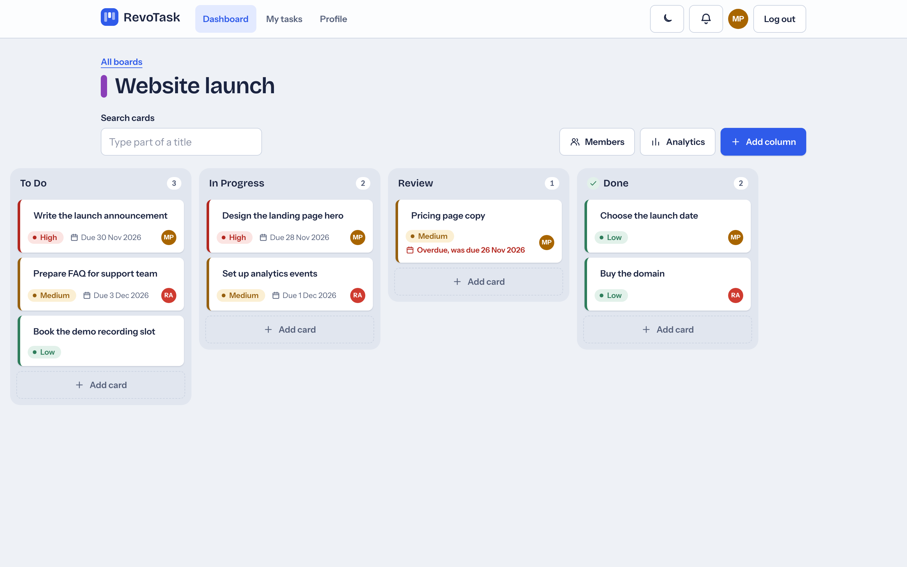
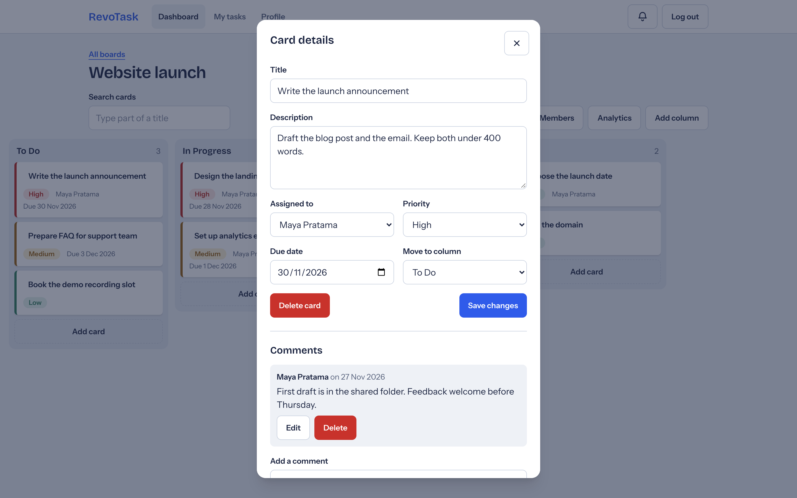
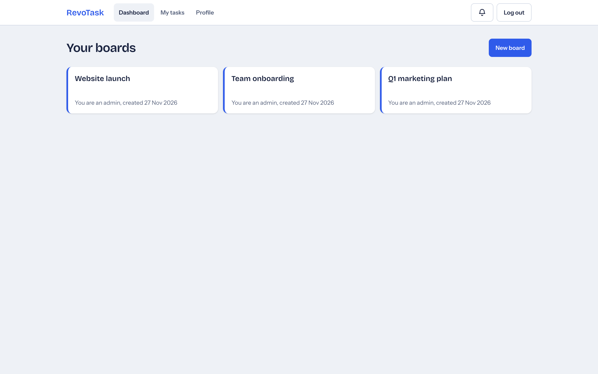
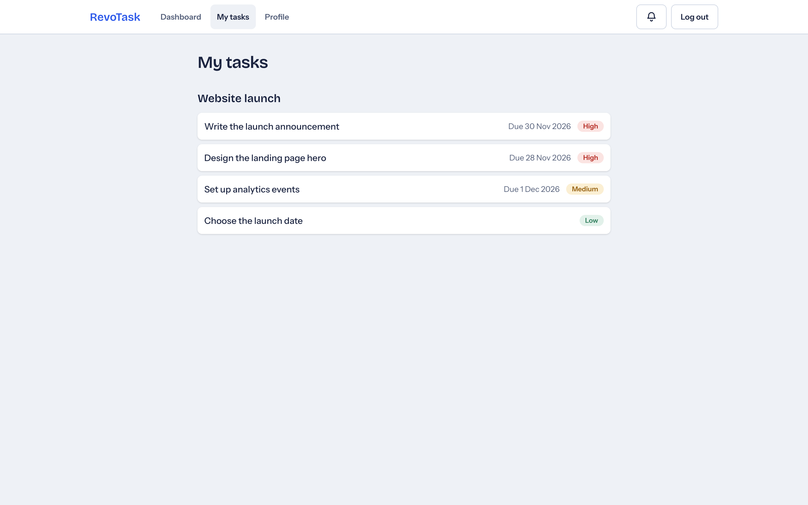
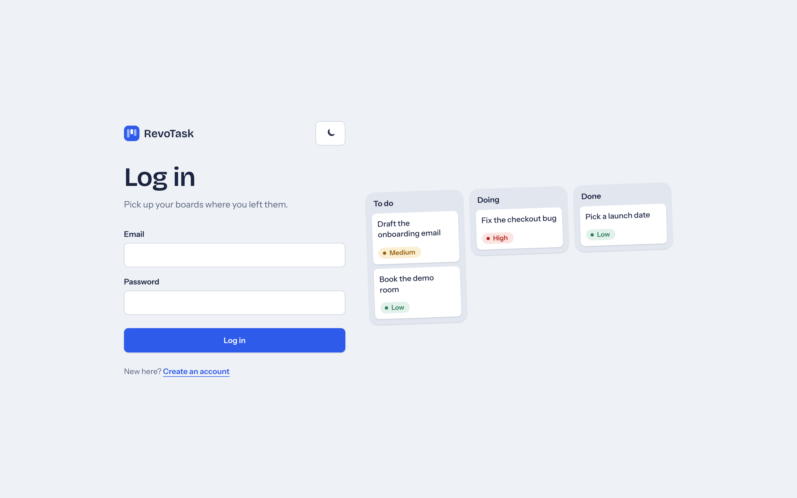
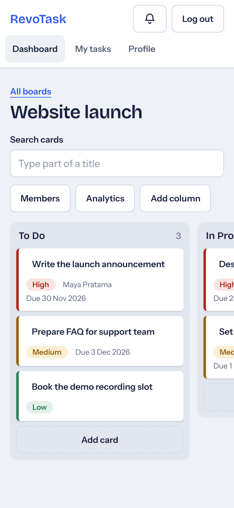
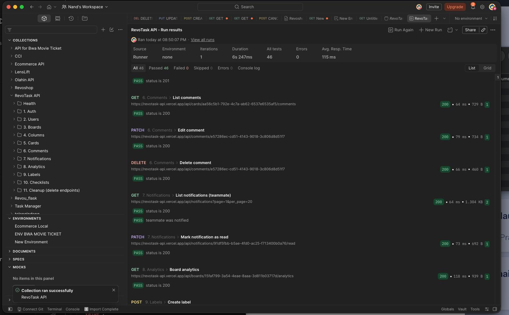

# RevoTask

A Trello-like task management app. Teams create boards, split work into columns, add cards, and move cards between columns by dragging them. Built as a Flask REST API and a Next.js web app, through a spec-driven, AI-assisted workflow.

| | URL |
| --- | --- |
| Web app | https://revotask-web.vercel.app |
| API | https://revotask-api.vercel.app |
| API health check | https://revotask-api.vercel.app/api/health |

Both run on Vercel in the Singapore region. The database is PostgreSQL on Neon, also in Singapore.

## Screenshots

| Kanban board | Card details and comments |
| --- | --- |
|  |  |

| Dashboard | My tasks |
| --- | --- |
|  |  |

| Login | Board on a 375 px phone |
| --- | --- |
|  |  |

## Features

- **Authentication.** Register, log in with a JWT that expires, log out. Pages redirect to `/login` without a session; the API answers `401`.
- **Boards.** Create, list, rename and delete boards. Each board has members with a role: admin or member.
- **Columns.** Add, rename, delete and reorder columns. A column can be marked as the "done" column.
- **Cards.** Create and edit cards (title, description, assignee, due date, priority). Drag a card within a column or to another column. The screen updates at once and rolls back if the API rejects the move. Deleting a card is a soft delete.
- **Comments.** Comment on a card. Edit and delete your own comments only.
- **Notifications.** A bell in the header shows unread notifications, refreshed every 30 seconds. You are notified when you are assigned a card, when someone comments on a card you created or are assigned to, and when you are added to a board.
- **My Tasks.** Every card assigned to you, grouped by board.
- **Card search.** Filter the cards on a board by title.
- **Profile.** Update your name and email.
- **Board analytics.** For admins: cards per column, cards completed this week, activity per member.
- **Light and dark theme.** A switch in the header; the choice is remembered, and without a choice the app follows the operating system.
- **Drag feedback.** A dragged card lifts, the column under it lights up, and a line shows where the card will land.
- **Colours that identify.** Every board and every person has a colour worked out from their ID, the same on every page.
- **Responsive.** Every page works on a 375 px screen. Cards can be moved without dragging through a "Move to column" field.

Access rule: a user who is not a member of a board gets `404` for it, so the board's existence is not leaked. A member without the needed role gets `403`.

## Technologies

| Area | Stack |
| --- | --- |
| API | Python 3.14, Flask 3.1, Flask-SQLAlchemy, SQLAlchemy 2.1, Flask-Migrate (Alembic), Flask-JWT-Extended, Flask-CORS, Marshmallow 4 |
| Database | PostgreSQL (Neon in production) |
| Web | Next.js 16 (App Router), React 19, TypeScript (strict), Tailwind CSS 4 |
| Tests | pytest, Jest + React Testing Library, Playwright |
| Hosting | Vercel (API and web), Neon (database) |

## Repository structure

```
.
├── specs/         project brief, requirements.md, design.md, tasks.md, CHANGELOG.md, reviews/
├── guidelines/    frontend.md, backend.md, database.md, comparison/, violation-report.md
├── backend/       Flask API: app/blueprints/<feature>/{routes,service,schema}.py
├── frontend/      Next.js app: app/, components/shared/, hooks/, lib/, e2e/
└── docs/          screenshots and the Postman collection
```

The API has 8 blueprints: `auth`, `users`, `boards`, `columns`, `cards`, `comments`, `notifications`, `analytics`. Each has its own `routes.py`, `service.py` and `schema.py`. Together they expose 30 endpoints.

## AI workflow summary

The project followed one chain: brief → requirements → design → tasks → code → tests. Every AI output was reviewed before it was committed.

1. **Brief.** I wrote [`specs/project-brief.md`](specs/project-brief.md) as the input for the spec phase.
2. **Specs with Kiro.** Kiro generated `requirements.md`, `design.md` and `tasks.md` from the brief. I reviewed each first version and recorded the findings in [`specs/reviews/`](specs/reviews/). Every change to the specs is logged in [`specs/CHANGELOG.md`](specs/CHANGELOG.md) with the text before and after (16 entries, CL-01 to CL-16).
3. **Steering guidelines.** [`guidelines/`](guidelines/) holds the rules for frontend, backend and database code. Each rule has a rationale and an example. [`guidelines/comparison/`](guidelines/comparison/) shows the same feature generated before and after the guidelines existed.
4. **Code with Claude Code.** Kiro's free credits ran out after the spec phase, so the implementation was done with Claude Code, working from the same specs and guidelines, one task group at a time: auth, boards, columns, cards, then comments, notifications, users and analytics, then the frontend.
5. **Review against the guidelines.** Generated code was checked against the guidelines and by tests. Six violations were found and fixed; each is recorded in [`guidelines/violation-report.md`](guidelines/violation-report.md) with the rule, the bad code and the fix. Examples: an N+1 query when loading a board (found only after the query-count test was made stricter), and a page that scrolled sideways on a phone.

Three things did not go to plan, and all are logged:

- **AI tool change.** The plan was Kiro for the whole project. It became Kiro for specs and Claude Code for code.
- **Hosting change (CL-15).** The specs named Railway for the API. Railway and Render both rejected my payment card, so the API moved to Vercel's Python runtime with a Neon database. The mentor approved the change.
- **A feature that was built and removed (CL-16).** After the MVP was live I added a visual upgrade as a new requirement (REQ-33). Its loading skeletons looked right in the browser but made the Kanban end-to-end test fail 4 times in 12 against a production build, so they were taken out again and the requirement was changed.

## Run locally

Requirements: Python 3.14, Node.js 20 or newer, PostgreSQL.

### API

```bash
cd backend
python -m venv .venv
source .venv/bin/activate
pip install -r requirements.txt
cp .env.example .env
```

Edit `.env`: set `DATABASE_URL` and `TEST_DATABASE_URL` to two empty PostgreSQL databases, and generate the two secret keys as the file explains. Then:

```bash
flask --app wsgi db upgrade
flask --app wsgi run --port 5000
```

Check it: http://localhost:5000/api/health

### Web

```bash
cd frontend
npm install
cp .env.example .env.local
npm run dev
```

Open http://localhost:3000.

## Run the tests

### API tests (pytest)

```bash
cd backend
source .venv/bin/activate
pytest
```

296 tests. They use the database in `TEST_DATABASE_URL` and wipe its tables on every run.

### Web unit tests (Jest)

```bash
cd frontend
npm test
```

87 tests. `npm run lint` and `npm run typecheck` check style and types.

### End-to-end tests (Playwright)

The suite runs against a deployed site, not a mock. To run it against production:

```bash
cd frontend
npx playwright install chromium
E2E_BASE_URL=https://revotask-web.vercel.app E2E_API_URL=https://revotask-api.vercel.app npm run test:e2e
```

Without the two variables it runs against `http://localhost:3000` and `http://localhost:5000`.

10 tests: 4 authentication scenarios, the 8-step Kanban journey (log in, create a board, add two columns, create a card, drag it to Done, reload, check it is still there), and 5 checks at 375 px. No test uses a fixed wait. Every run registers its own throwaway accounts. The report of the last run against production is in [`frontend/playwright-report/`](frontend/playwright-report/).

### API collection (Postman)

Import [`docs/postman/RevoTask.postman_collection.json`](docs/postman/RevoTask.postman_collection.json) into Postman and run the collection. It has one folder per blueprint and covers all 30 endpoints. It points at the production API; change the `baseUrl` variable to test a local one.

Run against production, 35 of 35 tests passed:



## Results on production

Measured on 27 November 2026.

| Check | Result |
| --- | --- |
| Playwright against the live URLs | 10 of 10 passed |
| Postman collection against the live API | 34 requests, 35 assertions, 0 failed |
| `GET /api/boards/<id>` with 200 cards, p95 (target: 500 ms) | 169 ms on a reused connection, 344 ms with a new connection per request |

The p95 figures come from 100 requests each, sent from Indonesia to a warm function; the response was 81 KB. The first request after the function has been idle is slower and is not part of these figures.

## Environment variables

Real values are never committed. The examples are [`backend/.env.example`](backend/.env.example) and [`frontend/.env.example`](frontend/.env.example).
